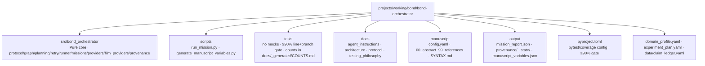

# BOND-ORCHESTRATOR — AGENTS.md

**BOND-ORCHESTRATOR (codename DAG 00)** — Layer 3 of the BOND suite: the
mission DAG runner. Executes multi-package film missions end-to-end over the
`MissionProvider` protocol, with checkpoint/resume and provenance on every
outcome. This is an active BOND phase-1 package under
`projects/working/bond/bond-orchestrator/`.

## Layer contract

| Surface | Rule |
| --- | --- |
| `src/bond_orchestrator/` pure core — `protocol.py`, `graph.py`, `planning.py`, `retry.py`, `runner.py`, `missions.py`, `providers.py`, `provenance.py`, `manuscript_variables.py`, `cli.py` | **No** `infrastructure.*` imports and **no** `bond_api` import; standalone-clean and liftable |
| `src/bond_orchestrator/film_providers.py` | The only module permitted to touch `bond_api`, and only via a **lazy** import inside a function body |
| `scripts/` | Thin orchestrators (sys.path bootstrap + argv forwarding only) |
| `tests/` | Real data + real computation; deterministic providers implementing the REAL protocol; **no mocks** |
| Frozen cross-package surfaces | The five `MissionProvider` methods, the `MissionPackage`/`MissionContext` shapes, and the `bond_api` protocol are consumed by `bond-cli`, `bond-coordinator`, and 27 film packages — additive change only |
| Live counts | Link `docs/_generated/COUNTS.md`; do not hardcode measured test totals or coverage % anywhere else |

Enforced by: `pyproject.toml` coverage gate (≥90% line+branch on `src/`),
`manuscript/layer_contract.yaml`, and the verification commands below.

## Overview

A mission is a DAG of film packages: dependency edges exist exactly where one
film's recon outputs feed another film's recon. The runner executes every
package through the five lifecycle phases (`brief`, `recon`, `plan`,
`execute`, `debrief`) in deterministic topological order, accumulating a
shared `MissionContext`, and produces a single consolidated debrief plus
per-outcome provenance records.

## Key features

- **Deterministic DAG execution** — canonical topological order (Kahn's
  algorithm, sorted ready-worklist); declaration-order independent.
- **Ordered cycle-path detection** — `FilmGraph.find_cycle()` returns the
  exact closed dependency path; `CycleError` names the loop.
- **Checkpoint/resume** — every completed `(phase, package)` step persisted to
  `<checkpoint-dir>/<mission>/`; resume replays completed steps and continues
  from the last completed step; execute steps persist their attempt count;
  `report.json` persisted at completion.
- **Deterministic retry policy** — bounded immediate re-attempts (no wall-clock
  backoff) on failing `execute` steps; `RetryRecord`s reported and persisted.
- **Parallel-stage planning** — wavefront `StagePlan` (achievable parallelism
  + critical path), rendered by the `plan` CLI command and carried in reports.
- **Provenance** — one `ProvenanceRecord` per executed step and per debrief
  (independent provenance writer; `outcomes.json` + `provenance.csv`, deterministic
  run id).
- **Real-film binding** — `film_providers.py` adapts real `bond-api`
  `MissionProvider` films to the orchestrator contract (lazy import keeps the
  pure core standalone-liftable).
- **Canned missions** — OPERATION OMNIBUS (chain), OPERATION DIAMOND
  (diamond), OPERATION SINGLET; `run <mission> [--checkpoint-dir]`, `plan
  <mission>`, `list`.
- **Manuscript variable hydration** — identity/mission parameters from
  `manuscript/config.yaml` + measured results from
  `output/data/mission_report.json`; prose never hand-authors metrics.
- **Zero-mock testing** — deterministic reference providers
  (`src/bond_orchestrator/providers.py`) implement the real protocol.

## Directory structure



## Usage

```bash
# From the package directory (canonical gates)
uv run pytest tests/ --cov=src --cov-fail-under=90

# CLI
uv run python scripts/run_mission.py list
uv run python scripts/run_mission.py OPERATION_OMNIBUS --checkpoint-dir output/state

# Manuscript token hydration (strict by default)
uv run python scripts/generate_manuscript_variables.py
uv run python scripts/generate_manuscript_variables.py --allow-draft   # N/A fallbacks
```

### Python API

```python
from bond_orchestrator import OPERATION_OMNIBUS, MissionRunner, get_provider

providers = {pid: get_provider(pid) for pid in OPERATION_OMNIBUS.package_ids()}
report = MissionRunner(providers, checkpoint_dir="output/state").run(OPERATION_OMNIBUS)
print(report.consolidated_debrief())   # single debrief
```

## Protocol for AI agents

- Start with `docs/agent_instructions.md` (all modifications).
- Consult `docs/architecture.md` before altering `src/` boundaries or adding
  modules.
- Consult `docs/testing_philosophy.md` before writing/modifying pytest files.
- Consult `docs/protocol.md` before changing the `MissionProvider` contract.

## Build / test / verify

There is no build step — the package is pure Python plus `pyyaml`. `uv sync`
installs the runtime dependencies and the local `bond-api` path dependency
declared in `pyproject.toml` (`[tool.uv.sources]`); the dev tooling
(`pytest`, `pytest-cov`, `numpy`) lives in the `dev` optional-dependency extra,
which uv does **not** install implicitly — request it with `--extra dev`.
`ruff` and `mypy` are not declared in `pyproject.toml` at all, so they are run
through `uvx` (uv's isolated tool runner), not `uv run`.

```bash
# Setup — the gate tools are not runtime deps; they live in the `dev` extra
uv sync --extra dev       # or pass `--extra dev` to any `uv run` command below

# 1. The enforced gate — tests + ≥90% line/branch coverage on src/
uv run pytest tests/ --cov=src --cov-fail-under=90

# 2. Lint + format check (uvx: neither tool is a declared dependency)
uvx ruff check src/ scripts/ tests/
uvx ruff format --check --line-length 120 src/ scripts/   # 120-col house rule; no
                                                         # [tool.ruff] is committed here

# 3. Types
uvx mypy src/          # the required scope
uvx mypy src/ scripts/ # scripts are typed too and must stay clean

# 4. Focused runs while iterating
uv run pytest tests/test_film_binding.py -v
uv run pytest tests/ -k retry -v
uv run pytest tests/ --cov=src --cov-report=term-missing   # find the gap
```

Additional invariant checks (all must report clean):

```bash
grep -rn "unittest.mock\|MagicMock\|@patch\|create_autospec" tests/ || echo "Clean — no mocks"
grep -rnE "^(from|import) infrastructure" src/bond_orchestrator/ || echo "Clean — pure core"
grep -rnE "^(from|import) bond_api" src/bond_orchestrator/ || echo "Clean — no module-scope bond_api"
```

The last one matters: `film_providers.py` imports `bond_api` **inside**
function bodies. A module-scope import would pass every other gate while
quietly making the pure core un-liftable.

Regenerating evidence (do this before quoting any output artifact):

```bash
uv run python scripts/run_mission.py OPERATION_OMNIBUS --checkpoint-dir output/state
uv run python scripts/generate_manuscript_variables.py
```

Live test count + measured coverage: `docs/_generated/COUNTS.md`. Do not copy
those figures into any other file.

## BOND-suite integration (wired in commit 728d8f3)

| Dependency | Status | What changed |
| --- | --- | --- |
| `bond-api` (frozen `MissionProvider`) | **wired** | `film_providers.py` adapts real bond-api providers to the runner contract; `bond-api` is a local path dependency (imported lazily so the pure core stays liftable) |
| `bond-utilities` (`mission_io`) | not declared / not wired | `provenance.py` does not import it and the schema differs (TODO V1); a delegation mapping is the pending integration |
| film packages (27) | **wired** | `film_providers.load_film_providers`/`load_mission_providers` discover real films from `src/` and bind them; `providers.py` reference classes remain for pure tests |

Real-film missions (e.g. goldfinger → goldeneye → no_time_to_die) run through
`MissionRunner` with checkpoint/resume + provenance; see `tests/test_film_binding.py`.

Residual acceptance criteria live in [`TODO.md`](TODO.md).
